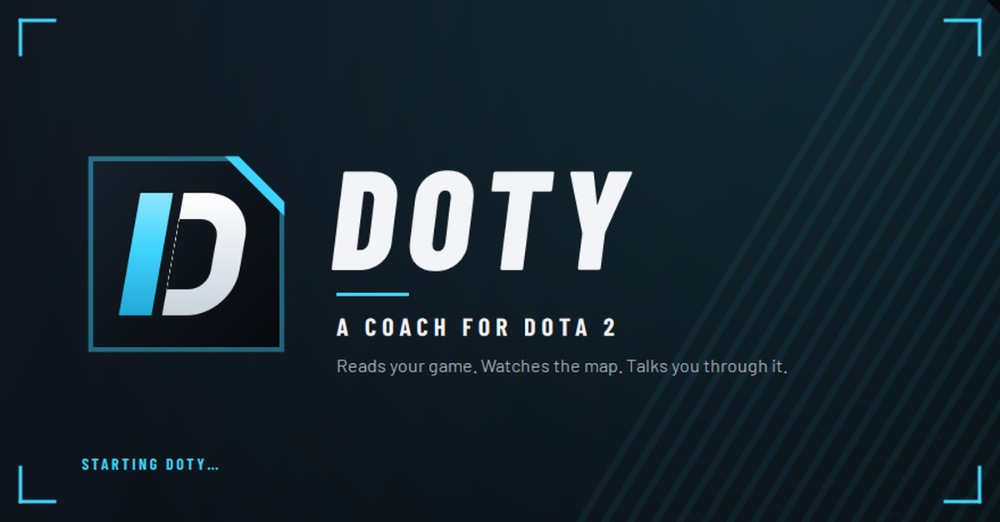

<p align="center">
  
</p>

<p align="center">
  <a href="https://github.com/bkeigh/Doty/releases/latest"></a>
  <a href="#linux"></a>
  
  
</p>

<h3 align="center">Reads your game. Watches the map. Talks you through it.</h3>

<p align="center">
  <a href="https://dotyweb.vercel.app"><b>Website</b></a> ·
  <a href="https://github.com/bkeigh/Doty/releases/latest"><b>Download</b></a> ·
  <a href="https://github.com/bkeigh/Doty/issues"><b>Report a bug</b></a>
</p>

---

**Doty is a free Dota 2 coach that sits next to your game and calls it.**
It's the Dota Plus assistant plus a human coach, without either.

It won't save you from a 0/7 Pudge. It *will* tell you he's coming.

## What it says

Every card is colour-coded, so you know what it is before you read it.

| | Tag | Means | Sounds like |
|---|---|---|---|
| 🔴 | **DANGER** | Act now | *"Back off now. Low HP, their side."* |
| 🟠 | **TIMER** | Coming up | *"Bounty and power runes in 15."* |
| 🔵 | **DOTY** | The coach | *"Lion is off the map. Wait for your team."* |
| 🟢 | **LEVEL** | Good | *"Skill point: take Greater Bash."* |
| 🟡 | **GOLD** | Money | *"You can afford Black King Bar."* |

## What it does

- **Instant calls.** Rune timers, objective windows, save items. Plain rules, under a millisecond, no AI needed.
- **An AI coach that points.** It circles the hero on your minimap and draws an arrow back to your tower.
- **Ask out loud.** Hold Mouse 5, say *"can I fight now?"*, let go.
- **Draft help.** Counter picks and bans from millions of public games at your rank.
- **Builds and counters** for every hero, by role and game phase, studied from public match data for this patch.
- **Your way.** Tell it how you play. It disagrees once, with a reason from this game, then follows your build.
- **Talks when it matters.** One budget for everything it says out loud; danger always gets through. Ask "why?" any time.
- **One thing to practise.** A focus each game, graded after it.
- **Post-game review.** What killed you, and what to fix next game.

## Get it

| | |
|---|---|
| **Windows 10 & 11** | **[Download DotySetup from Releases](https://github.com/bkeigh/Doty/releases/latest)** and run it. No admin prompt. |
| <a id="linux"></a>**Linux** | Runs from source today (native Linux Dota 2, X11). A packaged build is on the way. |

> **Windows says "protected your PC"?** The installer isn't code-signed yet. Click **More info**, then **Run anyway**. Each release ships a SHA-256 checksum if you want to check it. [SECURITY.md](SECURITY.md) lists what Doty does on your PC, what leaves it, and how to verify a download.

## Set up in a minute

1. Install Doty and open it. The **Setup** page walks you through the rest.
2. **Connect Dota.** One click, and Doty drops its game-data file into your Dota folder.
3. In Steam, add `-gamestateintegration` to Dota 2's **launch options**.
4. In Dota, set the display mode to **Borderless Window**. Exclusive fullscreen hides overlays.
5. *(Optional)* Pick an AI for the coach.

## Fair play

Doty only uses what you could see yourself.

- Never reads the game's memory.
- Never presses a key for you.
- Never looks up who's in your lobby. Its stats are about heroes; the only player it looks up is you (your public profile and recent matches).
- No telemetry, and no key of its own: the AI coach runs on your key, kept in Windows Credential Manager.

It runs on Valve's official **Game State Integration**.

## Bring your own AI

Timers, alerts, draft and heroes work with no AI at all. For the talking coach, pick one:

**Claude** (default) · **ChatGPT plan** · **Gemini** or **OpenRouter** free tiers · a **local model** with Ollama

On Claude, a 40-minute game costs roughly **5 to 12 cents**.

---

## Run it from source

Everything below is for running Doty from this repository, changing it, or reading how it works. To just use it, the installer above is all you need. Want to help? See [CONTRIBUTING.md](CONTRIBUTING.md).

**New here? Start with the [quick guide](docs/GUIDE.md):** what Doty is, how to install it, and what you'll
see during a game, in five minutes.

**How it works:**
- **Game data:** Doty reads Valve's official **Game State Integration** (the game POSTs its state to
  Doty ~10×/s).
- **Rules:** a deterministic rule engine runs on every update (sub-millisecond).
- **AI:** an AI of your choice (Claude by default; also your ChatGPT plan, Gemini or OpenRouter free
  tiers, or a free local model) handles judgment calls.
- **Fair play:** Doty never touches the game's memory or sends input, and never looks up the players in
  your lobby. It stays within what Valve allows. See [docs/RESEARCH.md](docs/RESEARCH.md) for the teardown of Cluely and Clicky this design
came from, and [docs/ARCHITECTURE.md](docs/ARCHITECTURE.md) for the stack and latency budget.

## Setup (Windows, one time)

```bash
python -m venv .venv
```

```bash
.venv\Scripts\pip install -e .[dev]
```

With an NVIDIA GPU, also install the CUDA runtime so push-to-talk transcribes in ~0.1 s instead of ~0.8 s.
It's about 1 GB and lives in the venv only.

```bash
.venv\Scripts\pip install -e .[gpu]
```

```bash
.venv\Scripts\python -m doty install
```

`install` writes `gamestate_integration_doty.cfg` into your Dota folder. Then:

1. **Steam → Dota 2 → Properties → Launch Options:** add `-gamestateintegration`.
2. **Dota → Settings → Video → Display Mode:** **Borderless Window**. Exclusive fullscreen hides overlays.
3. **For the AI coach (optional):** set an Anthropic API key, either in the app (Setup → Claude API key)
   or from a terminal. Rules, timers and voice work without it.

```bash
setx ANTHROPIC_API_KEY "sk-ant-..."
```

Check everything with:

```bash
.venv\Scripts\python -m doty doctor
```

## Use

**Double-click Doty on your desktop** (or open it from the Start menu). Doty is on whenever it's open
(it costs nothing while Dota is closed); then launch Dota. **Pause** stops it watching and listening until
you resume. To keep it on the taskbar, right-click its taskbar icon and choose **Pin to taskbar**.

Doty adds its Start-menu and desktop shortcuts the first time it opens. If you move the project folder,
add them again from **Settings > App**, or with:

```bash
.venv\Scripts\python -m doty shortcut
```

Opening Doty while an older copy is still running (say, in the tray after an update) closes the old one
and opens the new one, so you always get the latest version.

The window **follows the game**: hero selection opens Draft, the match start opens Coach, and Esc takes
you back (Settings > App turns this off). It never pulls you out of Setup or Settings.

The Doty window has four tabs: **Coach**, **Heroes** (with a **Draft | All heroes** switch at the top),
**Profile** and **Settings**. The setup checklist opens from Settings (**Setup checklist**, top right; the
Settings tab shows a dot while something needs you). The same status icon sits in the top bar, on the
overlay and in the tray: an eye while Doty watches, turning arrows while it waits.

- **Coach** changes with the moment:
  - **Not set up yet:** Get started, one step at a time with its button: Dota's connection file, the
    Steam launch option, your AI key (or "Not now"), a free natural voice, and a demo match.
  - **Before a match:** your last game's recap (result, K/D/A, what Doty noticed) with the post-game
    review: up to three things to work on, each death with what likely led to it (low HP in a fight, no
    TP, deep on their side, right after a warning), your core items against when your hero's players
    usually have them, and **Ask Doty about this game**. Then a box to plan
    your next hero, and the keys to remember.
  - **Hero selection:** the top cores and supports against their lineup, and the lineup's score.
  - **In a match:** laid out like a broadcast. The top bar carries the match (LIVE, your team, day or
    night, the clock). **What Doty sees** leads, with Doty's latest line captioned along the bottom as it
    talks. Under it, your hero: portrait, HP and mana bars (with a damage trail, like Dota's), items, the
    enemy lineup (click one for its page) and your gold, K/D/A, last hits and GPM, read from the game ~10×
    a second. The rail on the right has **Next up** (the next timers, the nearest one counting down),
    **Buy next** (the item you're building now with a gold bar toward what's left of it, what comes after
    it, and the items that answer their lineup: the same answer the overlay's strip, the spoken calls and
    the coach give), the feed of everything Doty says (urgent lines flash red) and
    the controls.
  - **What Doty sees:** a live picture of your Dota window, kept on this PC, as soon as Dota is open
    (menus, hero selection, the match). It holds still while Dota covers Doty, and while Doty covers Dota
    (it would only film Doty): put Doty on another screen to watch it live while you play.
  - **On a tall window** (a portrait monitor) the page stacks: the picture and your hero, then Next up
    beside Buy next, the feed, and the controls in one row.
  - **Status:** when everything works it's one line ("All set · Coach: Sonnet 5.5 · Voice: natural
    (Kokoro) · Mic: Shure MV6"). A problem shows as a chip with its fix: paste your key right there,
    unmute, or jump to the setting. Muting and turning things off are your choices, so they never show
    as problems.
  - **Ask now**, **5-minute plan** and one **Coach** menu at the foot of the rail: how chatty the coach
    is, plus Mute, **Hide for now** (the cards, until you show them again) and **Pause** under "Right now".
  - **Wrong tip?** Hover a coach line in the feed: it saves that line's screenshot, game state and the
    coach's full answer to `Documents\Doty\reports`, to attach to a bug report.
- **Heroes › Draft:** both teams as portraits, counter picks (cores and supports), bans worth making (until
  the bans are done), items to plan for, and a matchup grid with totals and a one-line verdict.
  - **Data:** hero-level statistics from millions of public games (OpenDota), at your rank.
  - **Picks:** filled in from your screen while the coach watches hero selection (your own pick goes in
    the first slot, marked YOU), or by hand: click a slot and type (Enter takes the first match), or drag
    a hero from the **hero pool** onto a slot. The pool filters by name, attribute, role and melee or
    ranged, and sorts by how well each hero does against their picks, by win rate or by name; heroes
    already in the draft are dimmed. Drag between slots to swap, drag a slot back to the pool to clear
    it, double-click a hero to add it to your team. Suggested picks and bans drag in too. Works without
    an AI key.
- **Heroes › All heroes:** every hero in a grid: type to filter, or filter by role, attribute and melee or
  ranged; sort by attribute, win rate, pick rate or name. Pick one for its build by game phase, its win
  rate at your rank, its spells (does BKB stop it, can it be dispelled), and what to buy against it; Esc
  goes back to the grid. It follows your hero once a game starts.
- **Profile:** your rank and your last 20 games, each with a 0–100 performance score (Turbo games aren't
  scored: the benchmarks are from normal games).
  - **Score:** your GPM, XPM, last hits, kills, damage and healing, against everyone who played that
    hero (OpenDota percentiles).
  - **Account:** it comes from the game data, or paste your Dotabuff/OpenDota link.
  - **Needs:** Dota's "Expose Public Match Data" setting turned on. It shows your own account only.
- **Setup checklist** (from Settings): what's left to do comes first, each step marked Required,
  Recommended or Optional, with a one-click fix (the next one in cyan). Passed checks fold into one line. Doty rewrites Dota's
  connection file by itself when your settings change. The free Kokoro voice and ElevenLabs sit under
  "Optional: a more natural voice".
- **Settings:** tabs jump to each section: the AI coach (provider, model, how often it looks, your
  experience and rank), voice (with a sample button), push-to-talk, overlay, alerts, app. Rarely
  needed switches sit in a folded **Advanced** card, including **Show technical details** (timings on the
  Coach page, in the feed and on alert cards). Saving restarts Doty with the new settings.

The look is a broadcast HUD: near-black panels with a cut corner, condensed capitals for labels and
numbers, and one cyan for Doty itself. Text is Barlow and Barlow Condensed (SIL Open Font License,
bundled). The app icon is original (`doty/ui/assets/doty.svg`): a dark tile with a cyan cut corner and a
leaning D whose stem is the wordmark's cyan slash. Doty's own branding uses no Valve art.
Hero portraits and item and ability icons are Valve's public images, the same ones OpenDota and Dotabuff
show: downloaded the first time a page needs them and cached on your PC, never bundled. Pages crossfade,
the tab underline slides, numbers count up, Doty's captions fade in and out, and loading areas shimmer;
every animation is under half a second.
Closing the window keeps Doty coaching from the tray; quit from the tray icon.

**Live coaching.** With an API key set, the coach looks at your screen and game state on its own (every
30 game seconds by default) and speaks up when something is worth interrupting you for: a fight going
wrong, an objective about to happen, an item or farm mistake. Quiet observations show dimmed in the feed. The coaching button
on the Coach page (and the tray menu) has four presets: **Quiet** (looks every minute, about 7¢ a 40-minute
game), **Balanced** (every 30 s, about 8¢), **Chatty** (every 15 s and says what it sees, about 12¢) and
**Only when I ask** (about 5¢: the opening plan and death looks). Live looks run on Haiku 5.5 and the parts of
each request that repeat are read from Anthropic's prompt cache; the Coach status shows what this game has cost
so far. Settings > AI coach has the exact intervals. Besides that rhythm it looks at calm
moments, when a plan is easiest to act on: after you respawn, after a fight, at level 6, when a big item
finishes. Live looks use a fast model (Haiku 5.5 on Claude) so they land sooner; your questions and plans
use the main one. A live tip is one sentence, spoken the moment it's written (while the rest of the answer
still streams in), and dropped if it would start too late or repeat what you heard in the last two minutes.

**Who's in the game.** Doty reads the ten top-bar portraits itself (a few milliseconds a frame), so it
knows your allies and enemies seconds after the game loads, and who's dead once it knows all ten. Each
look gives the coach a match brief: what every enemy hero's abilities do, their cooldowns, which go
through BKB, and when their players usually finish their big items.

**Instant calls (prepared ahead).** An AI answer takes a few seconds and a fight is over in about as long,
so the coach also thinks ahead: at each look it can arm up to three calls such as
`hp < 35 and enemy_side => Back off now` or `gold >= 4050 and no black_king_bar => Buy BKB now`. Doty checks
them against the game data ten times a second and says the line the moment it comes true, in milliseconds.
The conditions use a small fixed vocabulary (HP, mana, gold, level, clock, items, TP ready, ultimate
ready, in a fight, on their side of the map, day or night, and how many enemies or allies are dead on the
top bar); nothing the AI writes is ever run as code. Armed lines are voiced ahead, so a call plays the
instant it fires and cuts in over anything else.

**Prediction rules (no AI).** At the horn, a card with your skill order and core build (and when each item
usually lands). A gank warning when you cross the river with low HP or no TP, worse at night. An item-pace
nudge while there's still time ("Shadow Blade usually lands by 25:00: you're 1,800 gold short"). For the
first ten minutes, a laning gauge on the overlay: last hits a minute against a target for your hero. The
enemy's usual power spikes on a card, with a heads-up shortly before the first few ("Juggernaut's Battle
Fury usually lands by 15:00"). "Two enemies dead. Push a tower." when the top bar shows it, and "your
team is down: back off" when you're deep on their side.

**Colors** mean the same thing everywhere, in the window, the feed and the cards over Dota: red is act
now, amber is coming up, cyan is the coach, green is good, grey is plain information, and gold is gold.
Over the game, each card also carries a tag that says what it's about: DOTY, TIMER, GOLD, LEVEL, DANGER.

**Late tips are dropped, not shown.** A live tip that took more than ~9 seconds, or arrives after you died
or a fight started, is thrown away instead of shown late. While you're taking damage, Doty doesn't start
new looks at all. Drawings on the screen are dropped once the camera has moved on or a few seconds have
passed; drawings on the minimap last a little longer.

What the coach knows:

- **Your game, exactly**, from Dota's data feed: HP, mana, gold, items, abilities, K/D/A, the clock,
  and how many skill points you have to spend.
- **Your hero, from data, not memory:** what each ability does, the order pro players level them on the
  current patch (OpenDota), and the items this hero's players actually buy. A skill-point reminder names
  the skill ("Skill point: take Greater Bash"), and a live tip that suggests an item the hero doesn't buy
  (Blink Dagger on Spirit Breaker) is dropped.
- **The screen**, with close-ups of the minimap (who's showing where, who's missing) and the top bar.
- **Who's in the game:** it reads the ten heroes off the top bar, but a hero only counts once two reads
  agree, and your own hero (from the game data) fixes which side is yours. So one misread can't put an
  ally on the enemy team or add a hero who isn't in the game; tips that name such a hero are dropped.
  The app shows "vs Lion · Lina · …".
- **Matchups:** your hero's public win rate against each enemy (OpenDota).
- **A coaching playbook:** map reading; counter-items by enemy type (BKB vs disables, MKB vs evasion,
  Silver Edge vs passives, Spirit Vessel vs healing, detection vs invisibility, and more); power spikes;
  laning; objectives; roles.
- **Draft:** during hero selection it reads the picks on screen and suggests heroes that fit your team and
  counter theirs. Its suggestions are grounded in the same public statistics as the Draft page.
- **Not your opponents' identities:** Valve deliberately hides who is in your lobby until picks are
  done, and Doty respects that. It never looks up the players in your game; all its statistics are about
  heroes.

**The coach points at things.** When it helps, the coach draws on your screen:
- it circles a hero on the minimap, draws an arrow back to your tower, or boxes the item to buy;
- a cyan pointer glides to the spot first, so your eye knows where to go;
- heroes are colored by team: green for allies, red for enemies, neutral when Doty isn't sure;
- the drawings sit only over the part of the screen they point at;
- they disappear after a few seconds, and cost nothing when there's nothing to show.
Turn it off in **Settings > Overlay**.

The coach only ever marks things that are visible in your screenshot. The overlay sizes itself to your game
window: 1080p, 1440p ultrawide and 4K look the same, and the cards stay clear of the minimap, the hero
bar and your action bar.

**The status badge.** A small round badge sits above the cards:
- an eye: Doty is watching your game (green; amber if the AI coach is off);
- turning arrows: it's waiting for Dota's game data (amber), or the data stopped (red).

Hover it for the details in words. **Drag it to move the cards** anywhere over the game (Doty remembers the
spot), and double-click it to put them back. It's the only part of the overlay that takes the mouse, and it
never takes the keyboard from the game.

**Without game data** (before the launch option is set), the coach still works from screenshots while Dota
is the active window. Timers, instant alerts and exact stats need the game data.

**How Doty connects to Dota.** Doty listens on your own PC (port 53000; you never need to touch it).
Dota sends its game data there once:

1. the Game State Integration file is in your Dota folder (Setup installs it), and
2. Dota is launched with `-gamestateintegration` (Setup → Copy option, then Steam → Dota 2 → Properties →
   Launch Options).

Restart Dota after either step. If you have more than one Steam library, Doty installs into the one Steam
actually runs Dota from.

Prefer a terminal? This runs the same engine with just the overlay and tray:

```bash
.venv\Scripts\python -m doty run
```

| Hotkey | Does |
|---|---|
| **Hold Mouse 5** (forward side button) | **Push-to-talk:** ask anything out loud ("should I buy BKB or Manta?", "when's Roshan?"), then release |
| Ctrl+Alt+A | Ask Doty "what should I do right now?" (instant if a background answer is fresh) |
| Ctrl+Alt+P | 5-minute plan + item build (the build drives the "you can afford X" alerts) |
| Ctrl+Alt+M | Mute / unmute voice |
| Ctrl+Alt+H | Hide / show the overlay |
| Ctrl+Alt+X | "Not that one": drop the item Doty is pointing at from this game's build (or say "skip Black King Bar") |
| Ctrl+Alt+Y | "Why?": the reason for the last tip said (or ask "why?" over push-to-talk) |

### Push-to-talk

Hold the key and talk; Doty stops speaking and beeps. Release and it beeps again. Whisper transcribes
your question **locally** (no audio leaves your PC; only the text goes to Claude), shows what it heard
in a green card, and the coach answers in your ear.

- **Screenshot timing:** the screenshot is taken the moment you press, so the coach sees what you were
  looking at.
- **Follow-ups:** questions like "what about after that?" work, because the last few exchanges are kept.
- **Outside a match:** questions also work in menus or during hero selection.
- **First run:** downloads the speech model once, ~480 MB on GPU (small.en) or ~145 MB on CPU (base.en).
- **Test your mic:** run `doty mic`. Hold the key, talk, and see what Whisper heard and how fast.
  `doty mic --list` shows your microphones.
- **Choosing a mic:** if your Windows default recording device isn't a microphone (a capture card, for
  example), Doty picks a real mic itself. To choose one yourself, set `mic = "Shure"` (any part of the
  name) under `[listen]` in `doty.toml`.
- **Changing the key:** set `key` under `[listen]` (`mouse4`, `f8`, `ctrl+alt+t`, …). Dota still
  receives the key, so pick one it doesn't use.

### Choose your AI

Pick it in **Settings > AI coach**:

| Provider | Cost | How to connect |
|---|---|---|
| **Claude · API key** (default) | Pay per use with an API key. Claude Max and Ultra plans include API credits | Paste an Anthropic API key from the Claude Console |
| **Claude · Pro or Max plan** | Listed but not available | Anthropic doesn't allow other apps to sign in with a Claude plan (see below) |
| **ChatGPT · Plus or Pro plan** | Uses your plan | **Continue with ChatGPT**: OpenAI's official sign-in opens in your browser |
| **Gemini** | Free tier (Google may use free-tier data) | Paste a Google AI Studio key |
| **OpenRouter** | Free models (rate-limited) or paid | Paste an OpenRouter key |
| **OpenAI** | Pay per use with an API key | Paste an OpenAI API key |
| **Local model** | Free, offline, private | Install [Ollama](https://ollama.com), run `ollama pull gemma3`, click **Check** |

**Why there's no "sign in with Claude":** Anthropic's terms don't allow third-party apps to use Claude
Pro or Max subscriptions, so Doty uses a Claude API key. ChatGPT sign-in is OpenAI's official
program for open-source apps. Usage counts against your plan, and you can cap it in ChatGPT's settings.

The coach needs a model that can see images, because it looks at your screen. "Automatic" picks one for
you. Timers, alerts, Draft and Heroes all work with no AI at all.

### A human-sounding voice: Kokoro (free) or ElevenLabs (paid)

Out of the box Doty talks with the Windows voice: free, offline, robotic. Two voices sound like a real
person:

**Kokoro: free, on this PC.** In the **Setup checklist** (Settings, top right), click **Download (330 MB)** next to "Free natural
voice". That's a one-time download, with no account or key. Doty switches to it by itself. Pick one of
its voices in **Settings > Voice** (Heart sounds the most natural; Nicole is soft and close, good on
headphones) and click **Play sample**. **Tone: Warm** (the default) cleans up Kokoro's sound: it removes
the steady whistle its voice engine leaves at 4.8 and 9.6 kHz (the "ringing"), turns its fizzy top end
down to the level of natural speech, and softens harsh "s" sounds only while they spike. **Clear** does
the same with a little more sparkle; **Bright** is the original sound.

**Kitten: free, on this PC, softer.** Set **Voice service** to Kitten (KittenML's Kitten TTS Mini, Apache
2.0) and click **Download (82 MB)**. It's darker and warmer than Kokoro, with much less energy where the
ringing sits, and speaks a little slower (Doty evens that out). Eight voices; about 0.6 s for a short line
on the processor. Settings shows only the rows for the voice service you pick.

- **Speed:** it runs on the processor, using about a quarter of it so Dota keeps the rest.
  - **Fixed alerts** ("Back off, low HP", rune timers) are prepared in the background the first time
    Doty starts (~20 s, once), so they play instantly.
  - **New lines** start in about 0.6–1 s on a Ryzen 9 3900X; long coach answers speak sentence by
    sentence.
- **Private:** nothing leaves your PC.
- **Credits:** Kokoro-82M is by hexgrad (Apache 2.0). Text is turned into sounds with eSpeak NG (GPLv3).

**Faster on an NVIDIA GPU (running from source).** New lines start in ~0.15 s instead of ~0.6–1.1 s.
This needs the `[gpu]` extra, plus a one-time ~420 MB download into `.venv\kokoro-gpu`. The command
below sets it up and then tests it:

```bash
.venv\Scripts\python -m doty gpu-voice
```

Doty then uses the GPU by itself, and the Coach page shows "Kokoro · Heart · GPU". To turn it off, set
`kokoro_device = "cpu"` under `[voice]`. The installer always uses the CPU.

**ElevenLabs: paid, from the cloud.** Add an ElevenLabs API key in the **Setup checklist** (ElevenLabs >
Settings > API keys). Doty checks the key and switches over. Then pick a voice in **Settings > Voice**.

- **Speed:** Doty uses the Flash model (~100 ms) and streams the audio, so speech starts a few hundred
  milliseconds after a line is ready. Short lines it repeats are cached on this PC, so they play instantly
  and aren't billed again.
- **Cost:** ElevenLabs bills per character spoken; a game is a few thousand characters. See their pricing
  page for your plan.
- **Your key:** it's saved to your Windows user account (`ELEVENLABS_API_KEY`), like the Claude key.

**Which one speaks.** **Voice service: Best available** uses ElevenLabs when a key is saved, else Kokoro
once it's downloaded, else the Windows voice. If ElevenLabs runs out of credits or rejects the key, Kokoro
takes over (when downloaded). If a line can't be spoken, the Windows voice says it. Doty is never silent,
and the Coach page shows why it switched.

### Try it without Dota

```bash
.venv\Scripts\python -m doty demo --speed 10
```

This plays a scripted 26-minute match at 6× speed: a lost fight, a death, a missing TP, items left in
the stash, a Roshan kill with Aegis, and every rune timer. Add `--no-coach` to skip Claude calls.

### Other commands

- `doty run --record recordings`: save raw GSI payloads.
- `doty replay recordings\gsi-....jsonl`: play them back.
- `doty voices`: list installed voices.
- `doty gpu-voice`: run the Kokoro voice on an NVIDIA GPU (`--check` only tests it).
- `doty uninstall`: remove the GSI cfg.

## Share Doty (installer)

```bash
.venv\Scripts\python packaging\build.py
```

This builds `dist\DotySetup-<version>.exe` (~98 MB): a normal Windows installer with Start-menu and
desktop shortcuts and an uninstaller, and no admin prompt. It needs `pip install -e .[build]` and
Inno Setup 6 once. Every build self-tests the bundled app first. See
[docs/RELEASING.md](docs/RELEASING.md) for publishing, versions, code signing and API keys.

## Configure

Copy `doty.example.toml` to `doty.toml` and edit it. The main knobs:

- `coach.provider`: `claude` (default), `chatgpt`, `openai`, `gemini`, `openrouter` or `ollama`.
  `coach.provider_model` picks a non-Claude model (`""` = automatic).
- `coach.model`: `claude-sonnet-5-5` (default; $2/$10 per million tokens), `claude-opus-5-5` (deeper,
  twice the price) or `claude-haiku-5-5` (fastest, a few cents a game).
- `coach.bracket`: your rank for hero statistics (0 all, 1 Herald … 8 Immortal).
- `overlay.size` (0.85–1.4) and `overlay.draw` (let the coach draw on screen).
- `coach.speculative_interval_s`: how often the coach looks on its own (default 30 game seconds; 10 s to
  2 min, or 0 = only when you ask). Each look keeps the ask hotkey instant. At 30 s that's roughly $1 per
  40-minute game on Sonnet, $2 on Opus, a few cents on Haiku.
- `coach.speak_up`: what a look offers to say: `important` (default), `every` or `never`. The Coach page has
  quick controls for both, applied instantly.
- `coach.talk`: how much Doty talks out loud, the alerts and the coach together: `less`, `normal`, `more`, or
  `""` (default: by your level). Danger calls and your questions are always said. `hotkeys.why` (Ctrl+Alt+Y)
  explains the last tip.
- `rules.announce_stacks`: on for supports. `rules.muted_rules` silences specific rules.
- `voice.engine` (`auto`, `kokoro`, `elevenlabs`, `windows`), `voice.kokoro_voice` (`af_heart`,
  `am_michael`, `bm_george`, …; see `doty/kokoro.py`), `voice.eleven_voice`, `voice.voice` (Windows),
  `voice.rate`, `voice.min_priority`.
- `coach.own_way`: when you build differently, `once` (default: one argument per item, with a reason from this
  game), `follow` or `remind`. `coach.instructions`: your own words to the coach; Settings turns what it can into
  `coach.never_suggest` and `coach.hero_builds`.
- `overlay.mark_width` and `overlay.mark_opacity`: the drawings' line (2 px at 1080p) and how solid it is (0.65).
- `app.study`: study heroes' public statistics in the background (on). `record.enabled`: keep a record of each
  match on this PC (on; `record.keep_matches`, `record.keep_mb`). [SECURITY.md](SECURITY.md) says what's in it.

After changing `[gsi]`, re-run `doty install` and restart Dota.

## What Doty tells you

| Kind | Examples |
|---|---|
| Timers (fire 15 s early) | Bounty runes (0:00, then every 4:00), water runes, power runes, Shrines of Wisdom, lotus, Tormentors (with the side), neutral-item tiers, stacks (opt-in) |
| Roshan | The respawn window from the kill, which pit he's in (day/night, 7.41), Aegis expiry warning |
| Save calls | The instant you're bursted (or silenced mid-fight), the save item you have ready: "Glimmer yourself", "BKB now", "Manta the silence"; no AI needed |
| Survival | Low HP while losing HP, "Get out now" on a burst with no save item to press, no TP scroll, death streaks, no buyback (gold or cooldown) late |
| Economy | The next item part by part ("Buy Ogre Axe", then "Finish Black King Bar": parts you hold count), unspent gold (buyback kept from 30:00), items stuck in the stash, shop while dead |
| Progression | Unspent skill point, level 6, last hits at 10 and 20 minutes vs players of your hero, role and rank and the rank above (from the hero's card; the hero's OpenDota median until the card is studied; not for supports, and quiet in Turbo) |
| Live strip (overlay) | Countdowns to the next runes and objectives, and the item you're building with the gold still to pay and when you'll have it |
| Matchup | The game plan (which lineup a long game favours, from public win rates by game length), the enemy's usual power spikes, "two of them are dead: push", and once all five enemies are known, their biggest threat to your hero and its answer, from their spells ("Lion's Hex hexes you; answer: Linken's Sphere") |
| Focus | One thing to practise this game, said at the horn with a target ("This game: 40 last hits by 10:00"), checked once or twice, graded in the recap with your trend |
| Coach (Claude) | Lane plan at the horn, why you died (from your last seconds: HP, stuns, unused items), "what now?", 5-minute plan + build (with how your next item's win rate falls off the later it lands), answers to spoken questions, instant calls it prepares (back off when low, push when two are dead) |

Timings are for patch **7.41f**. Update `doty/knowledge/timings.py` when Valve patches the map.

## Tests

```bash
.venv\Scripts\python -m pytest
```

The tests cover:

- the state parsing
- every rule, driven by the scripted match
- the GSI server and its token check
- the coach's streaming pipeline, run against a local fake of the Claude streaming API so no key is needed
- push-to-talk, including a real Whisper transcription of a question spoken by Windows TTS
  (this one is skipped until a Whisper model has been downloaded)

**The bench** scores what Doty says, line by line, against the game as it stood:
`python -m doty.bench --scripted` (the demo match, rules only), `python -m doty.bench --latest` (your most
recent match records), or a session log. See [CONTRIBUTING.md](CONTRIBUTING.md).

## Code signing policy

**Status: releases are not code-signed yet.** Doty is preparing an application to the
[SignPath Foundation](https://signpath.org/) programme for open-source projects. If it is accepted, this
section will say: free code signing provided by [SignPath.io](https://about.signpath.io/), certificate by
[SignPath Foundation](https://signpath.org/).

- **How a release is made.** From the release after 0.1.1, the installer is built by GitHub Actions
  ([release.yml](.github/workflows/release.yml)) from the tagged commit in this repository, not on a
  developer's PC. Once signing is in place, a person approves each signing request before a release is
  published.
- **Committers and reviewers:** [bkeigh](https://github.com/bkeigh)
- **Approvers:** [bkeigh](https://github.com/bkeigh)
- **Privacy policy:** there is no Doty server and no telemetry. [SECURITY.md](SECURITY.md) lists everything
  Doty sends, to whom and when, and what it keeps on your PC.

## License

Copyright (C) 2026 bkeigh and the Doty contributors.

Doty is free software: you can redistribute it and modify it under the terms of the
[GNU General Public License](LICENSE), version 3 or (at your option) any later version. It comes with
**no warranty**; see the license for details.

The Windows installer also carries [eSpeak NG](https://github.com/espeak-ng/espeak-ng) (GPLv3 or later; its
source is at that link), which the free Kokoro voice uses to turn text into sounds. The Kokoro model is
Apache 2.0 and is downloaded by the app, not bundled.

## Credits

Doty is an independent community project, not affiliated with or endorsed by Valve Corporation. Dota 2 is a trademark of Valve Corporation. Hero and item art shown in the app is Valve's, loaded from their public servers and never bundled.

Type set in [Barlow](https://github.com/jpt/barlow) by Jeremy Tribby, under the SIL Open Font License.

<p align="center"><sub>Built for people who've been told "just ward more."</sub></p>
